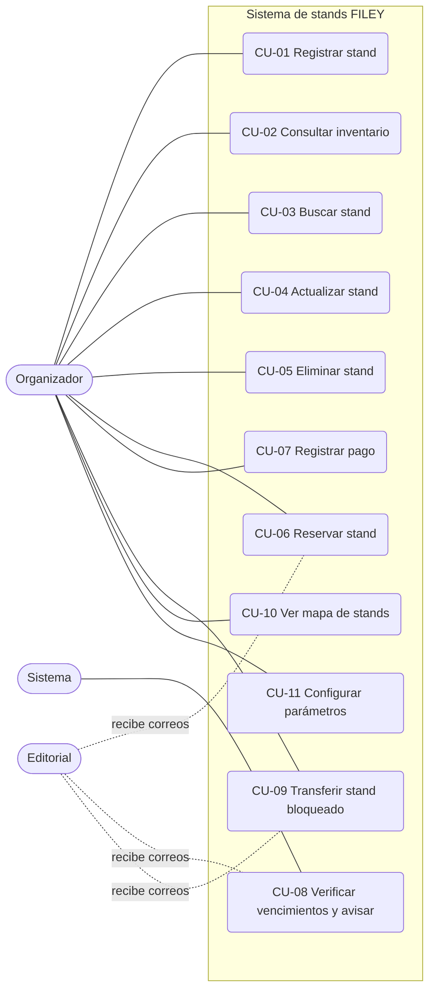
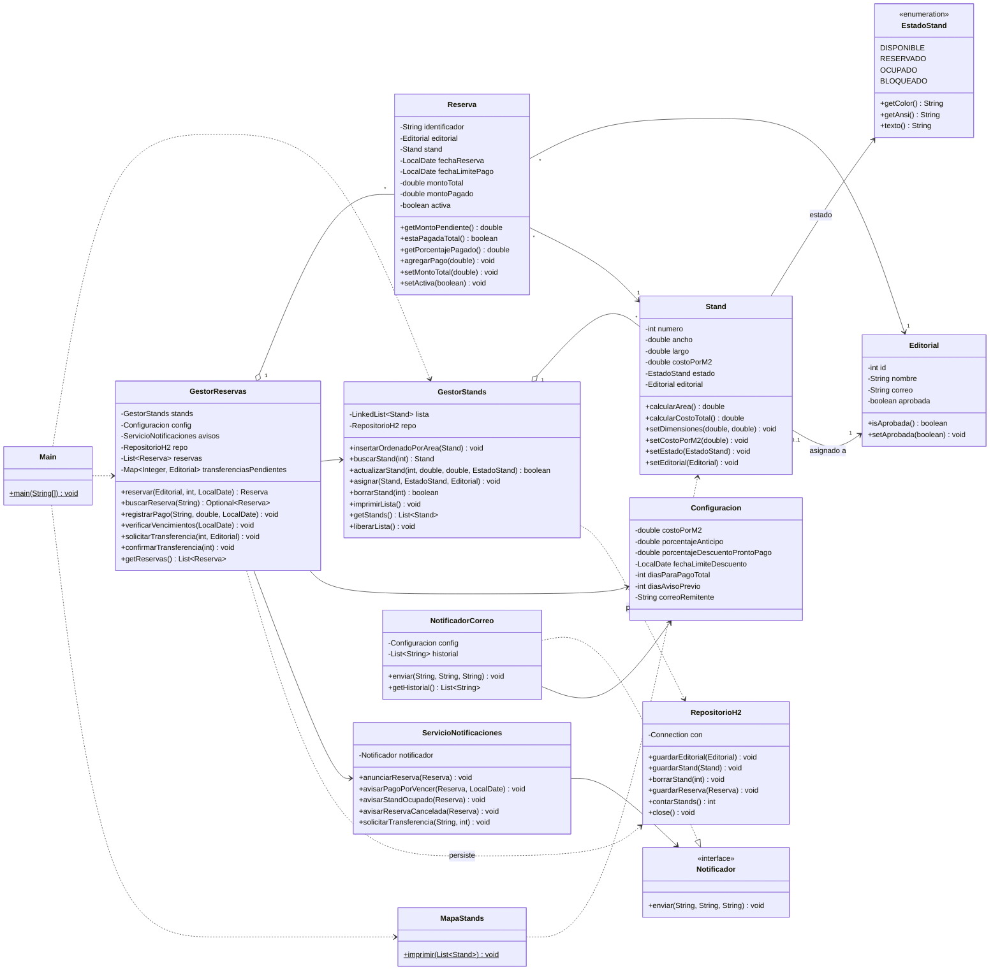
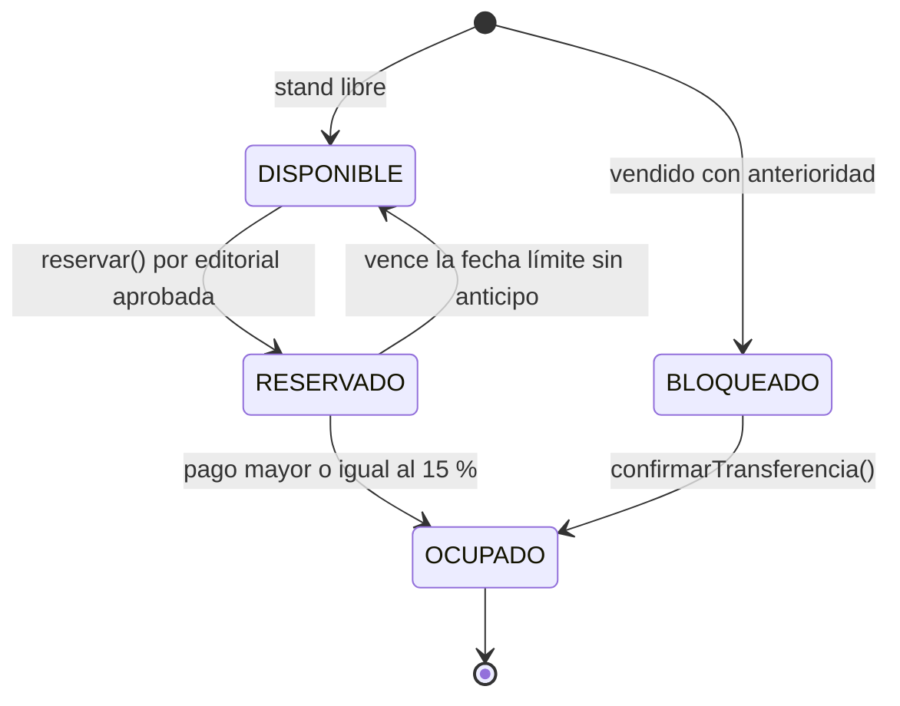

# Sistema de registro de stands – FILEY

Documentación del proyecto: casos de uso, historias de usuario y diagrama de clases.
Está alineada con el código del repositorio (paquetes `datos`, `operaciones`, `notificaciones` y `Main.java`).

## Índice

1. [Descripción general](#1-descripción-general)
2. [Estructura del repositorio](#2-estructura-del-repositorio)
3. [Reglas de negocio](#3-reglas-de-negocio)
4. [Actores](#4-actores)
5. [Casos de uso](#5-casos-de-uso)
6. [Historias de usuario](#6-historias-de-usuario)
7. [Diagrama de clases](#7-diagrama-de-clases)
8. [Diagrama de estados del stand](#8-diagrama-de-estados-del-stand)
9. [Separación de responsabilidades](#9-separación-de-responsabilidades)
10. [Cómo compilar y ejecutar](#10-cómo-compilar-y-ejecutar)
11. [Alcance y limitaciones](#11-alcance-y-limitaciones)

---

## 1. Descripción general

El sistema administra los stands de la feria FILEY: su inventario (ordenado por área), las reservas hechas por editoriales aprobadas, los pagos (anticipo y pago total), las notificaciones por correo, la transferencia de stands bloqueados (vendidos con anterioridad) y un mapa de colores con el estado de cada lugar.

Nació como un programa en C (lista enlazada de stands ordenada por área) y se migró a Java agregando los requisitos de las notas de análisis.

## 2. Estructura del repositorio

```
.
├── Main.java                         Pruebas del sistema por línea de comandos
├── DOCUMENTACION.md                  Este documento
├── datos/                            Clases de datos
│   ├── EstadoStand.java
│   ├── Stand.java
│   ├── Editorial.java
│   ├── Reserva.java
│   ├── Configuracion.java
│   └── RepositorioH2.java            Base de datos H2 en memoria
├── operaciones/                      Lógica de negocio
│   ├── GestorStands.java
│   ├── GestorReservas.java
│   └── MapaStands.java
└── notificaciones/                   Avisos por correo
    ├── Notificador.java              Interfaz
    ├── NotificadorCorreo.java        Implementación (envío simulado)
    └── ServicioNotificaciones.java   Mensajes de cada evento
```

## 3. Reglas de negocio

| ID | Regla |
|----|-------|
| RN-01 | Un stand tiene número (ID), dimensiones (ancho × largo), área en m², costo por m² y estado. El área y el costo total se calculan, no se almacenan. |
| RN-02 | El inventario se mantiene ordenado por área, de menor a mayor. Si una actualización cambia el área, el stand se reubica. |
| RN-03 | Los estados son cuatro: **Disponible** (verde), **Reservado** (amarillo), **Ocupado** (rojo) y **Bloqueado** (gris). |
| RN-04 | Solo las editoriales aprobadas pueden reservar. |
| RN-05 | Solo se puede reservar un stand en estado Disponible. Un stand Bloqueado no se reserva: se usa la transferencia. |
| RN-06 | Al reservar se fija una fecha límite para cubrir el pago total (por defecto, 30 días). |
| RN-07 | Al cubrir el 15 % del monto (configurable), la reserva pasa de Reservado a Ocupado. |
| RN-08 | Hay descuento por pronto pago (por defecto 10 %) si el monto se cubre a tiempo, antes de la fecha límite del descuento. Pasada esa fecha, el descuento ya no aplica. |
| RN-09 | Si vence la fecha límite y el stand sigue Reservado (no se alcanzó el anticipo), la reserva se cancela y el stand vuelve a Disponible. |
| RN-10 | Se avisa por correo a la editorial cuando se reserva, cuando el pago está por vencer (por defecto 5 días antes), cuando el stand pasa a Ocupado y cuando se cancela la reserva. |
| RN-11 | Un stand Bloqueado (vendido con anterioridad) se manda directo a la editorial para que haga la transferencia. Al confirmarse, pasa de Bloqueado a Ocupado sin pasar por Disponible, para evitar que se ponga a la venta por error. |
| RN-12 | Los parámetros (costo por m², porcentaje de anticipo, descuento, plazos, correo remitente) viven en una clase de configuración. |

## 4. Actores

| Actor | Descripción |
|-------|-------------|
| **Organizador** | Persona de la feria que administra stands, reservas, pagos y transferencias. Opera el sistema. |
| **Editorial** | Entidad que reserva y paga un stand. Interactúa con el sistema mediante los correos que recibe. |
| **Sistema** | Ejecuta acciones automáticas: cálculo de descuentos, cambios de estado, avisos y cancelaciones por vencimiento. |



## 5. Casos de uso

### CU-01 Registrar stand
- **Actor:** Organizador
- **Precondición:** el número de stand no está repetido.
- **Flujo principal:**
  1. El organizador indica número, ancho, largo, costo por m² y estado inicial.
  2. El sistema crea el stand y lo inserta en el inventario según su área (RN-02).
  3. Si hay base de datos, lo guarda en H2.
- **Flujo alterno:** si ancho o largo son menores o iguales a cero, el sistema rechaza el registro (`IllegalArgumentException`).
- **Postcondición:** el stand aparece en el inventario, ordenado por área.
- **Implementación:** `new Stand(...)`, `GestorStands.insertarOrdenadoPorArea()`.

### CU-02 Consultar inventario
- **Actor:** Organizador
- **Flujo principal:** el sistema muestra la lista de stands ordenada por área con su área, dimensiones, costo, estado y editorial asignada.
- **Alterno:** si no hay stands, muestra "La lista esta vacia.".
- **Implementación:** `GestorStands.imprimirLista()`.

### CU-03 Buscar stand
- **Actor:** Organizador
- **Flujo principal:** el organizador da el número y el sistema devuelve el stand.
- **Alterno:** si no existe, devuelve `null` y se informa "No encontrado".
- **Implementación:** `GestorStands.buscarStand(numero)`.

### CU-04 Actualizar stand
- **Actor:** Organizador
- **Precondición:** el stand existe.
- **Flujo principal:**
  1. El organizador indica nuevo ancho, largo y estado.
  2. El sistema actualiza los datos.
  3. Si el área cambió, saca el stand de su posición y lo reinserta para conservar el orden (RN-02).
- **Alterno:** si el stand no existe, devuelve `false`.
- **Implementación:** `GestorStands.actualizarStand()`.

### CU-05 Eliminar stand
- **Actor:** Organizador
- **Flujo principal:** el sistema quita el stand del inventario (y de H2 si está activa) y devuelve `true`.
- **Alterno:** si no existe, devuelve `false`.
- **Implementación:** `GestorStands.borrarStand()`.

### CU-06 Reservar stand
- **Actor:** Organizador (a petición de una Editorial)
- **Precondiciones:** la editorial está aprobada (RN-04); el stand existe y está Disponible (RN-05).
- **Flujo principal:**
  1. El organizador elige la editorial y el stand.
  2. El sistema crea la reserva con identificador (`RES-001`, `RES-002`...), monto total (área × costo por m²) y fecha límite de pago (RN-06).
  3. El stand pasa a Reservado y queda asociado a la editorial.
  4. El sistema envía a la editorial el anuncio de reserva con monto por pagar y fecha límite (RN-10).
- **Flujos alternos:**
  - Editorial no aprobada: se rechaza con mensaje.
  - Stand Bloqueado: se rechaza y se indica usar la transferencia.
  - Stand no Disponible o inexistente: se rechaza.
- **Postcondición:** reserva activa y stand en estado Reservado.
- **Implementación:** `GestorReservas.reservar()`.

### CU-07 Registrar pago
- **Actor:** Organizador
- **Precondición:** la reserva existe y está activa; el monto es mayor que cero.
- **Flujo principal:**
  1. El organizador registra el monto y la fecha del pago.
  2. El sistema suma el pago a lo ya pagado.
  3. Si se cubre todo con el descuento y la fecha está dentro de la fecha límite del descuento, se aplica el descuento por pronto pago (RN-08).
  4. Si el avance es al menos el 15 % y el stand está Reservado, pasa a Ocupado y se avisa a la editorial (RN-07).
- **Flujos alternos:** reserva inexistente, cancelada o monto inválido: se rechaza.
- **Implementación:** `GestorReservas.registrarPago()`.

### CU-08 Verificar vencimientos y enviar avisos
- **Actor:** Sistema (disparado con una fecha de referencia)
- **Flujo principal:** por cada reserva activa que no esté pagada por completo:
  1. Si la fecha límite ya pasó y el stand sigue Reservado: se cancela la reserva, el stand vuelve a Disponible y se avisa a la editorial (RN-09).
  2. Si faltan los días de aviso previo o menos para la fecha límite: se envía aviso de pago por vencer con el monto pendiente (RN-10).
- **Implementación:** `GestorReservas.verificarVencimientos(fecha)`.

### CU-09 Transferir stand bloqueado
- **Actor:** Organizador; la Editorial recibe el correo
- **Precondición:** el stand está Bloqueado.
- **Flujo principal:**
  1. El organizador solicita la transferencia indicando la editorial.
  2. El sistema envía el correo pidiendo que realice la transferencia.
  3. Al confirmarse, el sistema desbloquea el stand y lo pasa a Ocupado asignado a la editorial (RN-11).
- **Flujos alternos:** si el stand no está Bloqueado, o no hay transferencia pendiente al confirmar, se rechaza.
- **Implementación:** `GestorReservas.solicitarTransferencia()` y `confirmarTransferencia()`.

### CU-10 Ver mapa de stands
- **Actor:** Organizador
- **Flujo principal:** el sistema imprime la cuadrícula de stands con el color de su estado, la leyenda, y la lista de lugares elegidos con su editorial.
- **Implementación:** `MapaStands.imprimir()`.

### CU-11 Configurar parámetros
- **Actor:** Organizador
- **Flujo principal:** se modifican costo por m², porcentaje de anticipo, porcentaje y fecha límite del descuento, días para pago total, días de aviso previo y correo remitente.
- **Implementación:** setters de `Configuracion`.

## 6. Historias de usuario

| ID | Historia | Criterios de aceptación |
|----|----------|-------------------------|
| HU-01 | Como **organizador**, quiero registrar stands con sus dimensiones, ID y costo, para tener el inventario de la feria. | El stand se crea con área calculada y costo total (área × costo por m²). No se aceptan dimensiones menores o iguales a cero. |
| HU-02 | Como **organizador**, quiero ver el inventario ordenado por área, para identificar rápido los stands por tamaño. | La lista se muestra de menor a mayor área; al cambiar dimensiones, el stand se reubica. |
| HU-03 | Como **organizador**, quiero buscar un stand por su número, para consultar su estado y datos. | Si existe se muestra; si no, se informa que no se encontró. |
| HU-04 | Como **organizador**, quiero actualizar o eliminar un stand, para corregir el inventario. | La actualización y la eliminación indican si tuvieron éxito. |
| HU-05 | Como **organizador**, quiero que solo las editoriales aprobadas puedan reservar, para asignar espacio únicamente a quienes fueron autorizadas. | Una editorial no aprobada recibe rechazo; el stand no cambia. |
| HU-06 | Como **editorial**, quiero reservar un stand disponible, para asegurar mi lugar en la feria. | La reserva recibe identificador, el stand queda Reservado y se me envía el monto y la fecha límite. |
| HU-07 | Como **editorial**, quiero que mi stand pase a Ocupado al pagar el 15 %, para tener mi lugar confirmado. | Con el 15 % o más pagado, el estado cambia a Ocupado y recibo confirmación. |
| HU-08 | Como **editorial**, quiero un descuento si pago pronto, para ahorrar en el costo del stand. | Si cubro el monto con descuento antes de la fecha límite del descuento, el total se reduce; después de esa fecha no aplica. |
| HU-09 | Como **editorial**, quiero recibir un aviso antes de que venza mi pago, para no perder mi reserva. | El correo indica días restantes, monto por vencer y fecha límite. |
| HU-10 | Como **organizador**, quiero que las reservas sin anticipo se cancelen al vencer el plazo, para liberar stands que no se van a ocupar. | Pasada la fecha límite sin 15 % pagado, la reserva se cancela, el stand queda Disponible y se avisa a la editorial. |
| HU-11 | Como **organizador**, quiero manejar los stands bloqueados mediante transferencia, para no ponerlos a la venta por error. | El stand Bloqueado no se puede reservar; se avisa a la editorial y, al confirmar, pasa directo a Ocupado. |
| HU-12 | Como **organizador**, quiero ver un mapa con colores por estado, para conocer de un vistazo la ocupación de la feria. | Verde = Disponible, amarillo = Reservado, rojo = Ocupado, gris = Bloqueado; se listan los lugares elegidos con su editorial. |
| HU-13 | Como **organizador**, quiero configurar costo, anticipo, descuento y plazos, para ajustar el sistema sin cambiar el código. | Los valores se modifican en `Configuracion` y las operaciones posteriores los usan. |

## 7. Diagrama de clases



> Los diagramas están en Mermaid, por lo que GitHub los dibuja automáticamente al abrir este archivo.

## 8. Diagrama de estados del stand



`actualizarStand()` también permite al organizador fijar el estado manualmente (por ejemplo, para cargar datos iniciales o corregir el inventario).

## 9. Separación de responsabilidades

| Paquete | Responsabilidad | No debe saber de |
|---------|-----------------|------------------|
| `datos` | Representar la información (stand, editorial, reserva, estado, configuración) y respaldarla en H2. | Reglas de negocio, mensajes. |
| `operaciones` | Aplicar las reglas: orden del inventario, reservas, pagos, vencimientos, transferencias y mapa. | Cómo se envía un correo. |
| `notificaciones` | Redactar y enviar avisos mediante la interfaz `Notificador`. | Cómo se calcula un pago o una regla. |

El envío real de correo se puede cambiar creando otra implementación de `Notificador` (por ejemplo con JavaMail) sin modificar la lógica del negocio.

## 10. Cómo compilar y ejecutar

Requisitos: JDK 17 o superior. Para usar la base de datos, el jar de H2 (`com.h2database:h2`) en una carpeta `lib/`. Sin el jar, el programa funciona igual pero sin base de datos.

Desde la raíz del repositorio (PowerShell en Windows):

```powershell
javac -d out -cp "lib/*" Main.java datos/*.java operaciones/*.java notificaciones/*.java
java -cp "out;lib/*" Main
```

En Linux o Mac, el separador del classpath es `:` en lugar de `;`.

`Main.java` ejecuta las pruebas por línea de comandos: inserción ordenada, búsqueda, actualización, borrado, reservas, anticipo del 15 %, descuento por pronto pago, rechazos, transferencia, avisos, cancelación por vencimiento y mapa final.

## 11. Alcance y limitaciones

- El sistema se opera por código y pruebas en consola; no tiene interfaz interactiva.
- Los correos son simulados: se imprimen y se guardan en un historial.
- H2 se usa como respaldo (solo escritura) de los datos que maneja la lógica en memoria; al terminar el programa, la información se pierde.
- Cada stand admite una editorial y las reservas se identifican con un consecutivo (`RES-001`...).
- La aprobación de editoriales se representa con el atributo `aprobada`; no hay un módulo de solicitudes de editoriales.
